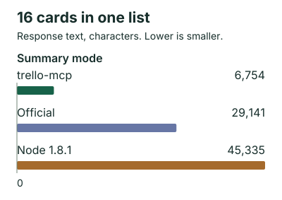
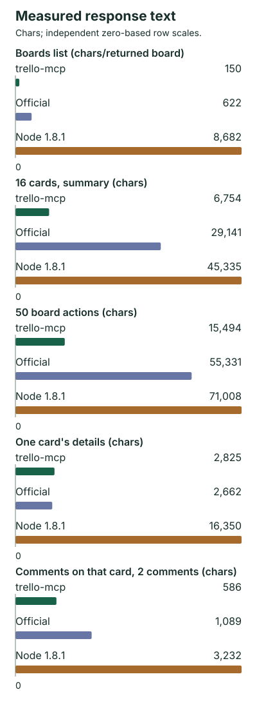
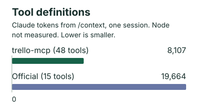

<h1 align="center">trello-mcp</h1>

<p align="center">
  Local Trello MCP server in Go. 48 tools, compact responses, guest boards.
</p>

<p align="center">
  <a href="https://github.com/avhn/trello-mcp/releases"></a>
  <a href="https://github.com/avhn/trello-mcp/actions/workflows/ci.yml"></a>
  <a href="LICENSE"></a>
  <a href="docs/setup.md"></a>
</p>

<!-- measured:start -->


77% less response text than the official server for this call (summary mode). Measured 2026-10-17 on one private work board with 144 cards; characters, not tokens. Full mode: 9,112 (69% fewer). For one card's details the official server returned less: 2,662 vs 2,825. [All results and method](#measured-comparison).
<!-- measured:end -->

## Install

```sh
curl -fsSL https://raw.githubusercontent.com/avhn/trello-mcp/main/install.sh | sh
```

Windows: `irm https://raw.githubusercontent.com/avhn/trello-mcp/main/install.ps1 | iex`. Checksum-verified.

Or give your agent:

```text
Set up trello-mcp by following https://raw.githubusercontent.com/avhn/trello-mcp/main/docs/setup.md; ask me to run its printed absolute-path auth command myself in a private terminal, then reconnect. Never capture authentication output.
```

Then: run the printed `auth` command yourself in a private terminal, register, reconnect.
Clients and Claude Desktop: [docs/setup.md](docs/setup.md).

<!-- measured:start -->
## Measured comparison





Claude Code /context in one session; rows over 1k display-rounded to 0.1k. Node could not be loaded into /context. Separately, tools/list: 20,583 vs 33,766 characters (39% fewer vs Node), not tokens.

| Call | trello-mcp | Official | Node 1.8.1 | vs Official | vs Node |
| --- | --- | --- | --- | --- | --- |
| Boards list, per returned board (characters/board) | 150 | 622 | 8,682 | 76% fewer | 98% fewer |
| 16 cards, summary (characters) | 6,754 | 29,141 | 45,335 | 77% fewer | 85% fewer |
| 16 cards, full (characters) | 9,112 | 29,141 | 45,335 | 69% fewer | 80% fewer |
| 50 board actions (characters) | 15,494 | 55,331 | 71,008 | 72% fewer | 78% fewer |
| One card's details (characters) | 2,825 | 2,662 | 16,350 | 6% more | 83% fewer |
| Comments on that card, 2 comments (characters) | 586 | 1,089 | 3,232 | 46% fewer | 82% fewer |
| Tool definitions (Claude tokens) | 8,107 (48 tools) | 19,664 (15 tools) | Not measured | 59% fewer | n/a |

One board, one day, one account. trello-mcp at commit cb40466 (v1.0.3); Atlassian hosted https://mcp.trello.com/v1 over OAuth, results captured verbatim from a headless Claude Code session; @delorenj/mcp-server-trello 1.8.1 via npx. Board list figures are characters per returned board over different sets (16 / 15 / 29; Node includes 13 closed boards; the extra trello-mcp board is a guest board in another organization). Card details and comments use one card with two comments. The board is private, so others cannot rerun on the same data. Official results reflect its hosted version on that date. Tool definitions are Claude tokens from /context; chars/4 would give about 5,146 for trello-mcp instead of 8,107.

[Aggregate data](docs/benchmarks/2026-10-17.json). Percent fewer = round(100 * (1 - ours/theirs)); per-board values are rounded totals/count.

I use Trello with AI assistants a lot, so I built trello-mcp to make it lighter and easier to use.

A thought: with AI agents, managing context may be one of the main optimizations we need to make now. Every tool definition and response a model reads takes space from the actual task, and as context grows, output quality tends to drop.

Features checked 2026-10-17.

| Feature | trello-mcp | [Official](https://github.com/atlassian/trello-mcp-server) | [Node 1.8.1](https://github.com/delorenj/mcp-server-trello/blob/v1.8.1/src/index.ts) |
| --- | --- | --- | --- |
| Runs | Local binary | Hosted, OAuth | Local, Node or Bun |
| Guest boards | Yes | Not reached in the owner's check, 2026-10-16 | Yes |
| Delete comments | Yes | No: list, add, edit | Yes |
| Create, update, delete labels | Yes | No: list, attach, detach | Yes |
| Attachments | Upload and download to disk, opt-in, Unix | Listing only | Any local path upload, inline base64 download |
| Per-object workspace allowlist | Yes | Per-workspace OAuth consent | Listing and some workspace operations |
| Server-side read-only mode | Yes | n/a (hosted) | Not documented |

Choose official for zero install, web and mobile, Inbox, Planner or keyword search.
<!-- measured:end -->

## Read-oriented profile

Ten read tools ([placement](docs/setup.md#optional-read-oriented-profile); `board_use` sets the local default board):

```text
TRELLO_TOOLS=workspace_find,board_find,board_use,list_find,card_find,card_get,comment_find,checklist_get,checklist_items,server_health
```

## Synthetic reference

Synthetic fixtures versus raw Trello JSON for the same objects, regenerated by `go test ./internal/bench -update`.

<!-- bench:start -->

| Scenario | Raw Trello JSON | this server | reduction |
| --- | --- | --- | --- |
| 20 boards | ~2166 | ~433 | 80.0% |
| 30 cards in a list | ~9266 | ~2968 | 68.0% |
| 20 comments | ~6739 | ~4311 | 36.0% |
| 50 board actions | ~11910 | ~4248 | 64.3% |
| 22 card actions | ~4888 | ~1368 | 72.0% |
| Card with 20 comments | ~7404 | ~4465 | 39.7% |

Synthetic raw pretty JSON is a reproducible reference, not measured output from another MCP server. Tokens use chars/4.

| Startup cost | Default (48 tools) | Read-oriented discovery (10 tools) |
| --- | --- | --- |
| tools/list | 20694 chars (~5174 tokens) | 4400 chars (~1100 tokens) |
| Initialize instructions | 140 chars (~35 tokens) | 141 chars (~35 tokens) |
| Initialize result (including instructions) | 304 chars (~76 tokens) | 305 chars (~76 tokens) |

| Independent response | Characters | Tokens (chars/4) |
| --- | --- | --- |
| card_find summary (30 cards) | 11873 | ~2968 |
| card_find full (30 cards) | 15023 | ~3756 |
| board_activity all (50 actions) | 16994 | ~4248 |
| board_activity commentCard | 5835 | ~1459 |
| board_activity updateCard | 5476 | ~1369 |

<!-- bench:end -->

## Docs

[Setup](docs/setup.md) · [Configuration and security](docs/configuration.md) · [Tools](docs/tools.md)

## License

[GPL-3.0-or-later](LICENSE), copyright Mert Dede (MIT up to v0.5.0). Independent Go implementation of the
[delorenj/mcp-server-trello](https://github.com/delorenj/mcp-server-trello) 1.8.1 (MIT) tool surface, not a
runtime dependency. Trello is a trademark of Atlassian. trello-mcp is an independent project, not affiliated
with or endorsed by Atlassian.
